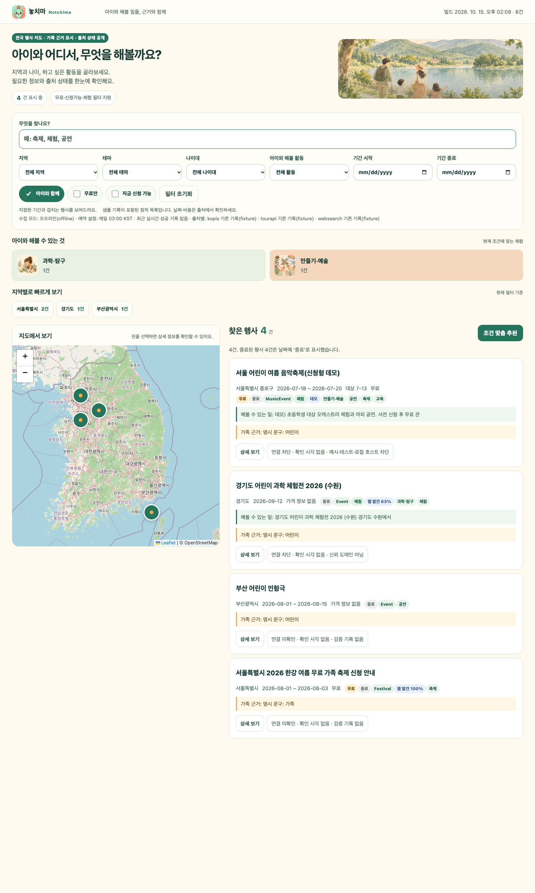
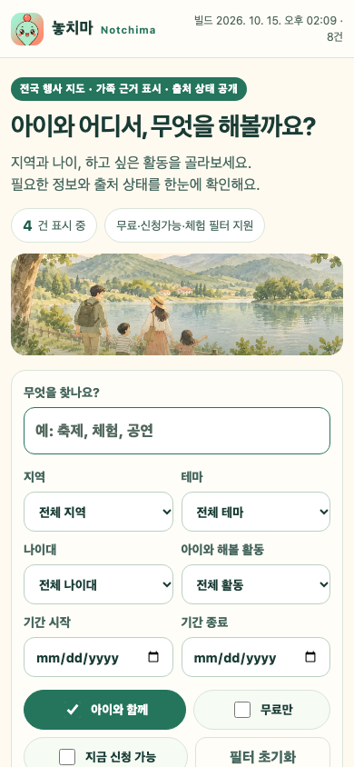

<h1>
  
  놓치마 <small>(Notchima)</small><br/>
  <sub>기회, 다 챙겨드릴게요.</sub>
</h1>

[](https://github.com/akillness/happy-our-planning/actions/workflows/ingest.yml)
[](https://www.python.org/)
[](tests/test_pipeline.py)
[](docs/02-data-model-okf.md)
[](https://happy-our-planning.vercel.app/)
[](docs/00-overview.md)

> **놓칠 뻔한 기회를 대신 챙겨주는 행사 비서.** 대한민국 지도 기반 **행사 발견 · 신청 매크로 · 마감 알람 · AI 주간 플래닝**.
공연·축제·전시·교육·공모·정부지원이 흩어져 마감을 놓치는 사람을 위해 — 지도에서 발견하고, 매크로로 신청하고, 알람으로 지키고, AI가 주간 일정으로 큐레이션한다.
무료 공공 API + flat-file 지식 DB(llm-wiki) + 무료 SaaS(free tier)로 **월 0원** 운영을 목표로 한다. <sub>(코드네임: happy-our-planning)</sub>

## 핵심 기능
- 🗺️ 지역(시/도·시군구) · 기간 · 나이대 · 테마 · 키워드 5축 검색 + 가족 행사 기본 탐색(`kids=true`, URL `kids=0` 해제)
- 🤖 신청기간 내 신청 보조 매크로 (Playwright 러너, 약관 준수로 반자동 강등)
- 🔔 마감임박·신규 알람 + 중복억제 (Telegram/dry-run, 채널 토큰 주입 시 실전송)
- 🧠 프로필 기반 AI 주간 플랜 추천 (규칙 랭킹 + Gemini 구조화, 폴백 보장)

## 설계 한 줄 요약
공공 API → 정규화(schema.org/Event = Open Knowledge Format) → **git 안의 Markdown 파일 = 지식 DB** →
사전 빌드 JSON → 정적 UI(검색/지도). 신청 매크로와 알람은 백엔드 스크립트(Playwright/Telegram)에만 구현; 스크립트가 적재·매크로·알람을 구동.

## 미리보기 (2026-10-15 빌드 실캡처, fixture 8건 기준)
> 로컬 정적 서버 + Playwright Chromium 실렌더. 상단 히어로(통계 pill·수채화 오버레이), 5축 필터 + 출처 투명성 고지, 체험/지역 퀵칩, Leaflet 지도 마커, 종료 배지 카드까지 한 화면 검증.
<p align="center">
  
</p>
<p align="center">
  
</p>
- Git 연동 운영 배포: **https://happy-our-planning.vercel.app/** (Vercel Hobby, `akillness/happy-our-planning`의 `main`, Root Directory `web/public`). `https://notchima.vercel.app/`은 Git 연결이 없는 별도 Vercel 프로젝트이며 이번 자동 배포 소스와 구분한다.
- 캡처 검증: 데스크톱 1440x2400 풀페이지 + 모바일 390x844, 360px 가로 넘침 없음, 44px 터치 타깃 유지

<p align="center">

## CI 워크플로우 (.github/workflows/ingest.yml)
<p align="center">
  
</p>

## 구조 (모듈 그래프)
<p align="center">
  
</p>

## 문서 (구체 설계)
| 문서 | 내용 |
|---|---|
| [docs/00-overview](docs/00-overview.md) | 비전·제약·성공기준 |
| [docs/01-architecture](docs/01-architecture.md) | 시스템 아키텍처·디렉터리 |
| [docs/02-data-model-okf](docs/02-data-model-okf.md) | OKF/schema.org 데이터 모델 |
| [docs/03-data-sources-apis](docs/03-data-sources-apis.md) | 무료 API 카탈로그 |
| [docs/04-ingestion-pipeline](docs/04-ingestion-pipeline.md) | 일일 수집 파이프라인·지식 DB(llm-wiki) — 오프라인 픽스처·public API·웹검색 적재 |
| [docs/05-search-and-map](docs/05-search-and-map.md) | 정적 UI 검색·지도 — family-first 필터, 행사 경험(손-활동), 링크 검증 캐시(7day/GET/async) |
| [docs/10-roadmap-milestones](docs/10-roadmap-milestones.md) | 로드맵·마일스톤·리스크 |
| [docs/11-discovery-sqlite-ai](docs/11-discovery-sqlite-ai.md) | 웹검색 발견·SQLite·Gemini (2026 개선) |
| [docs/12-naming-brainstorm](docs/12-naming-brainstorm.md) | 네이밍 브레인스토밍·후보 평가 |
| [docs/13-brand](docs/13-brand.md) | 브랜드 가이드(이름·슬로건·마스코트·컬러) |

## 개발 에이전트 역할 (.codex/agents/)
경량 AI 협업 팀 구성(선택 기능, 제약 자동 검증 없음):
- **review.toml**: 코드 리뷰, 기존 규칙/패턴 준수 검증
- **design.toml**: UI/UX 개념, 컴포넌트 설계, 지도 인터랙션
- **implementation.toml**: 기능 구현, 파이썬 스크립트·JS 모듈
- **collection.toml**: 정해진 스키마에 따른 결정적 데이터 추출·정규화 (저비용 역할, 종합 오케스트레이션 아님)

## 레이아웃
```
docs/         계획 문서
knowledge/    지식 DB (llm-wiki: index.md + events/** + schema/)
config/       sources/regions/themes/age-bands 통제 어휘
scripts/      ingest(공공+웹검색) · normalize · build(+sqlite) · recommend(+gemini) · macro · notify
web/          정적 프런트엔드 (Leaflet + Fuse.js)
.github/      ingest 워크플로우 (일 1회 cron)
assets/       브랜드 자산 (마스코트·아이콘 원본)
```

## 빠른 시작 (오프라인, 키 불필요)
샘플 fixture(`raw/**/sample-*`)로 전체 파이프라인이 네트워크 없이 돈다.
```bash
pip install -r requirements.txt
python -m scripts.run_pipeline          # 수집(웹검색 포함)→정규화→검증→인덱스→SQLite→wiki
python -m unittest discover -s tests    # 단위 테스트 200개 (197 통과 / 3 스킵: 기존 매크로 E2E 3종은 번들 Chromium 미설치로 스킵)
python -m scripts.ingest.websearch      # 웹검색 발견 후보(Exa/Brave/Tavily, 오프라인 픽스처)
python -m scripts.build.build_sqlite --query 축제   # SQLite FTS5 전문검색 데모
python -m scripts.recommend.rank        # 규칙기반 추천 + 주간 플랜(JSON)
python -m scripts.recommend.ai_planner  # Google AI Studio(Gemini) 플래너(+규칙 폴백)
python -m scripts.notify.dispatch       # 마감임박/신규 알람(드라이런)
python -m scripts.macro.apply           # 신청 매크로 잡 계획(약관 게이팅)

# 정적 사이트 미리보기
cd web/public && python -m http.server 8000   # → http://localhost:8000
```
실제 운영 시 `.env`(`.env.example` 참고)에 무료 API 키를 넣으면 어댑터가 원격 수집으로 전환.

## 실데이터 live 수집 (fixture → 실데이터 전환)
> 현재 공개 데이터는 fixture 기반 offline 8건. 아래 키를 넣으면 다음 파이프라인부터 실데이터로 수집된다.
> 키는 채팅에 붙여넣지 말고 로컬 `.env` 파일에만 기록 (`.env`는 gitignore, 커밋·로그에 값 미출력).

| 키 | 발급처 (무료) | 용도 |
|---|---|---|
| `KOPIS_KEY` | kopis.or.kr 회원가입 → 오픈API 인증키 | 공연/전시 live 수집 |
| `TOURAPI_KEY` | data.go.kr → 한국관광공사 국문관광정보서비스 활용신청 | 축제 live 수집 |
| `EXA_API_KEY` / `BRAVE_API_KEY` / `TAVILY_API_KEY` (택1) | 각 제공자 무료 티어 | 웹검색 행사 발견 |

```bash
cp .env.example .env   # 후 .env에 키 입력 (에디터로, 채팅 금지)
python -m scripts.ops.check_keys          # 보유 현황만 확인 (값 미출력)
python -m scripts.ops.check_keys --probe  # 출처별 1회 소량 요청으로 키 유효성 확인
python -m scripts.run_pipeline            # live 수집 → 검증 → 빌드 (키 있으면 자동 live)
python -m unittest discover -s tests      # 206종 회귀 가드
```
- 일일 cron도 동일 키 사용: GitHub repo Settings → Secrets에 위 키 등록 (`.github/workflows/ingest.yml`에 이미 secrets 패스스루 구성됨).
- 키 없이도 파이프라인은 fixture 모드로 rc==0 보장 (제약 C1).

## 일일 자동 수집 (GitHub Actions, KST 03:00 = UTC 18:00)
```yaml
# .github/workflows/ingest.yml
on:
  schedule:
    - cron: "0 18 * * *"        # 매일 03:00 KST
  workflow_dispatch: {}          # 수동 실행 가능

concurrency:
  group: ingest
  cancel-in-progress: false      # 동시 실행 직렬화, 중복 취소 안 함
```
**작업**: fetch→normalize→upsert→validate→build→wiki → git commit/push (실패 시 published 미변경, 진단 artifact 7일 보존)

**선택 링크 검증**(opt-in):
- 환경변수 `NOTCHIMA_CHECK_LINKS=1` 설정 시에만 활성화
- 운영 cron 설정에서 자동 활성화: `NOTCHIMA_CHECK_LINKS=${{ github.event_name == 'schedule' && '1' || '0' }}`
- 브라우저 등의 bounded GET 방식 + 리다이렉트 3회 한도, HEAD 검증 불사용
- 최근 7일 내 `verified` HTTPS만 `link_url` 공개, 재사용(fresh proof cache)
- 실제 검사 40건 한도·120초 예산 내 — 예정 어린이 경험 우선
- 검사 결과는 `web/public/data/link-checks.json`(URL 해시 키 캐시, 원본 URL 미저장)

**오류 복구** (실패 시 안전 조치):
- 일일 cron 실패 → `knowledge/sources/collection-status.json`에 소스별 `mode/last_success_at/error` 기록
- fixture 빌드 시각은 live 성공으로 오인하지 않음 (마지막 성공한 실제 API 수집만 기록)
- 이전 성공 데이터 (`published_at`)는 보존, 부분 실패 시 성공한 소스만 업데이트
- `updated.json`의 `source_mode`(offline/live/mixed) + `collection_error_count`로 투명 공개

**90일 파생 보존 정책**:
- 유효 종료일(`end_date || start_date`)이 KST 오늘-90일보다 이전인 행사만 `events.json`·정적 상세에서 제외
- 원본 knowledge 파일 및 모든 이력은 삭제 없이 보존
- `updated.json.publication`에 `retention_days`, `retained`, `excluded` 건수 보고

## 40 URL / 120초 링크 검증 큐
- 현재 공개 eligible events 집합만 검사 대상
- fresh verified proof(7일 이내 완료) 재사용 → 네트워크 skip
- 예정 중 어린이 경험(`is_experience=true`) 우선, 나머지 나이순 역순
- 더 이상 공개되지 않는 URL의 증명 정리(같은 해시 캐시만)
- 네트워크 실패/타임아웃 시에도 행사 레코드 보존, `link_status/reason` 투명 공개

## 지금 동작하는 것 (검증됨)
- ✅ KOPIS·TourAPI 어댑터 → schema.org/Event(OKF) Markdown 적재, content_hash 증분 upsert + archived 정책
- ✅ JSON Schema 검증 게이트, `events/facets/regions/updated.json` 빌드
- ✅ 정적 UI: Leaflet 지도 + 5축 필터(지역/기간/나이/테마/키워드) + `free_only` + 가족 기본 탐색(`kids=true`) + Fuse 검색(지역·체험·근거 포함 8키) + 클릭 진입 가능 AI 추천 다이얼로그
- ✅ 종료 상태 정합성: `derive_status`가 `end_date` 경과를 우선 `종료`로 파생, UI `statusInfo`·정렬·추천 제외와 일치 (2026-10-15 검증: 종료 7건 + 일정미정 1건)
- ✅ 출처 투명성: 빌드 3일 경과 시 stale 경고, 지도 미표시 건수 안내, link 차단/미확인 사유 상시 표시 (verified 0건도 데드엔드 없이 안내)
- ✅ 규칙기반 추천/주간 플래너(무료, LLM 폴백), 마감임박 알람 + 중복억제
- ✅ 신청 매크로 계획(`plan_job`) + 약관 자동제출 게이팅(반자동 강등 보장, 미제출 CI 가드)
- ✅ Playwright 기반 E2E 매크로 러너 (mock 폼 자동 제출 및 결과 캡처, chromium 없을 시 fake-page 스파이로 회귀)
- ✅ Telegram 알림 채널 (토큰 주입 시 실제 전송, 무토큰 시 dry-run 무오류)
- ✅ 지식 wiki 자동 인덱싱(REGIONS/THEMES/SOURCES)
- ✅ 웹검색 발견 레이어(Exa·Brave·Tavily) — 신뢰도/날짜/지역 가드로 OKF 후보 적재, `🔎 발견` 배지
- ✅ SQLite(libSQL) 파생 인덱스 `events.db` — FTS5 한국어 전문검색 + sido/theme/status 교차필터
- ✅ Google AI Studio(Gemini) 주간 플래너 — responseSchema JSON 강제 + 환각 가드 + 규칙 폴백
- ✅ 가족 친화 판정 (`family_friendly`·`family_evidence`) — 명시 근거(`age`, `age_bands`, `audience`, `name`, `description`, `themes`) 보수적 분석, 성인전용/노키즈/정보부족 제외, unknown 보존
- 정적 이미지 자산 — 기존 `family-outing.webp`/`family-outing-mobile.webp` 경로에 새 자연·가족 수채화 적용(161,798/73,390 bytes), 과학·만들기 활동 그림 추가. Codex 생성 이력·SHA-256은 `assets/design/family-assets.json`에 보존하며 런타임 제공자 호출은 없다.
- Pencil 새 시안 A/B/C 비교 후 **A · 선명한 탐색** 적용 — 검색 우선, 160px 데스크톱 그림, 모바일 목록 우선. 시안·모바일·상태 설계와 선정 근거: [`assets/design/pencil-proposals/selection.json`](assets/design/pencil-proposals/selection.json).
- 수채화·Fancy UI 최종 검증: Chrome **58/58** (고정 KST·통제 fixture), 360px 가로 넘침 없음, 주요 44px 타깃·활동 이미지/선택/URL·추천/포커스 복귀 확인. 종료·마감 배지 대비는 렌더 값 기준 **5.53:1**이다. 초기 수동 배포 당시의 9개 HTTP 200·SHA-256 검증과 이후 Git 배포 검증은 배포 JSON에서 구분한다. 공개 데이터는 샘플/오프라인이며 실시간 수집 성공을 뜻하지 않는다.
- Vercel Hobby 운영 주소: **https://happy-our-planning.vercel.app/**. `web/public` 정적 Git 배포이며 파생 DB·설계 원본·별도 Cloudflare Worker는 배포하지 않는다. 초기 수동 업로드와 이후 Git 배포의 관측 기록은 [`specs/verify/evidence/vercel-release.json`](specs/verify/evidence/vercel-release.json)에서 구분한다.
- 일일 수집 push에도 개편이 유지되도록 UI·수집/빌드 코드·테스트·네 WebP를 같은 `origin/main` 변경 집합으로 관리한다. 별도 `notchima` 프로젝트의 연결이나 배포 설정은 변경하지 않았다.
- Fancy UI 개편 (2026-10-15): 히어로 eyebrow 배지 + 통계 pill + 수채화 그라디언트 오버레이, 카드 entrance 애니메이션, 다이얼로그 등장 모션, 지도 다건 카운트 배지, 칩 hover 전환, 로딩 shimmer, 전역 reduced-motion 대응. 사용자 노출 em-dash 제거.
- ✅ 공통 HTTP 재시도 헬퍼(`scripts/common/http.py`) — 429/5xx 지수 백오프, 4xx 즉시 실패, AI 플래너 연동

## 상태
- M0–M6 코어 및 검증 슬라이스 동작(샘플 데이터). Playwright 매크로 러너 및 Telegram 알림 채널 구현, Vercel 정적 운영 배포 완료. 실 API 키를 통한 라이브 수집·호스팅된 cron 실행·시/도 경계 GeoJSON은 별도 미검증/미구현 범위다.